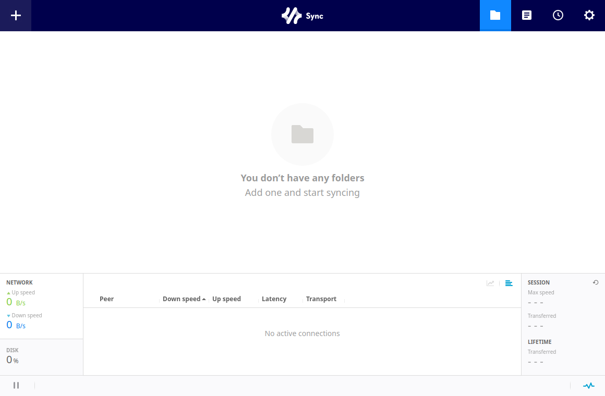

# SyncPilot

A native desktop shell for [Resilio Sync](https://www.resilio.com/individuals/) (`rslsync`) on Linux — it embeds the **official Resilio Web UI** in a desktop window, so the interface and workflow are exactly the official Windows/macOS client experience, with everything Linux was missing on top: daemon lifecycle, autostart, crash watchdog and a first-run installer for the official binary.

[](https://github.com/turinglambdaai/syncpilot/releases/latest)   [](https://github.com/turinglambdaai/syncpilot/actions/workflows/ci.yml) [](LICENSE)

**English** · [中文](README.zh-CN.md)

SyncPilot runs and manages the official `rslsync` daemon behind a native window that shows the official Resilio Web UI. It talks to the daemon over loopback only — your keys and files never leave your machine.
<p align="center">
  
</p>

SyncPilot is built on [Rivet](https://github.com/turinglambdaai/rivet): one Racket domain core (daemon manager, conf generation, auth-injecting proxy, settings) driving a first-party GTK4 host over typed RPC — the host only renders and interacts, all logic lives in the backend.

## Features

- **Official interface, zero drift** — folders, peers, transfers, preferences, activation: every screen and interaction is the official Web UI, version-matched to your rslsync build. Nothing to re-learn, nothing to re-implement
- **Daemon lifecycle** — one-click start/stop, adopt an already-running daemon (systemd, previous session), crash watchdog with exponential backoff, optional keep-running-on-exit
- **First-run install of rslsync** — if no official binary is found, SyncPilot downloads it from Resilio's CDN (sha256-pinned) into `~/.local/bin`
- **Online updates** — a daily background check against an Ed25519-signed release manifest (key id `syncpilot-2026-10`); SyncPilot asks before downloading, verifies the signed size and SHA-256, and hands you the verified tar.gz — your rslsync data is never touched
- **Desktop integration** — tray presence, hide-to-tray on close, launch at login (XDG autostart), single-instance restore
- **Safe by construction** — the Web UI stays bound to `127.0.0.1` with app-generated credentials; the backend serves it through a loopback auth-injecting proxy so you never see a login prompt, and the daemon never serves an unauthenticated request
- **Drop-in upgrade** — data paths and formats are byte-identical with 0.4.x (`~/.local/share/site.jrtx.syncpilot`); settings, device identity and the daemon config carry over untouched

## Honest gaps

- **Updates don't self-replace** — the updater downloads and signature-verifies the new tar.gz, but applying it is still a manual extract over the app directory

## Install

Grab an installer from [Releases](https://github.com/turinglambdaai/syncpilot/releases/latest). Every release ships the same matrix for **x64** and **arm64**:

| Format | Files (per version) | Notes |
|---|---|---|
| deb | `syncpilot-<version>-linux-amd64.deb` · `…-arm64.deb` | installs under `/opt/syncpilot` with a desktop entry and icon |
| rpm | `syncpilot-<version>-linux-x86_64.rpm` · `…-aarch64.rpm` | same payload as the deb |
| AppImage | `syncpilot-<version>-linux-x64.AppImage` · `…-arm64.AppImage` | carries its own GTK4 dependency closure — runs on distributions older than the build image |
| tar.gz | `syncpilot-<version>-linux-x64.tar.gz` · `…-arm64.tar.gz` | unpack and run `RivetHost`; also the update payload the in-app updater downloads and verifies |
| portable zip | `syncpilot-<version>-linux-x64.zip` · `…-arm64.zip` | same layout as the tar.gz |

Each file ships with a `.sha256` sidecar, plus a combined `SHA256SUMS`, a CycloneDX SBOM and third-party notices per architecture, and the Ed25519-signed `update-stable.json` manifest the in-app updater consumes. Ubuntu 24.04+ ships the required GTK 4 / WebKitGTK 6.0; everything else is bundled or base-system.

If the official `rslsync` binary is not found (auto-detection covers `~/.local/bin`, `/usr/bin`, `/usr/local/bin`, `/opt/resilio-sync`, `$PATH`), SyncPilot offers to download it from Resilio's CDN on first launch (sha256-pinned, installed to `~/.local/bin`) — or install it yourself and point SyncPilot at it in **Settings**.

## Updates

SyncPilot has an in-app updater; the full contract lives in [docs/UPDATE.md](docs/UPDATE.md). In short:

- it checks the signed `update-stable.json` feed **once a day** (silent startup auto-check, throttled to one check per 24 h; a manual check in the UI always runs),
- an available update is downloaded **in-app** and its size and SHA-256 are verified against the signed manifest before it is offered,
- **applying it is manual**: extract the new tar.gz over the app directory and restart `RivetHost` — rslsync data and settings are never touched.

## Building from source

Linux (or WSL2) with Racket CS 9.x, CMake, and the GTK4/WebKitGTK 6.0 dev packages:

```bash
raco pkg install --auto --no-docs https://github.com/turinglambdaai/rivet.git
raco rivet build        # generates clients, compiles the backend bundle, builds the host
raco rivet dev          # develop loop: rebuild + relaunch on change
raco test racket/       # domain-core tests
```

Details and manual CMake steps: [linux/README.md](linux/README.md).

## How it works

```
┌────────────────────────────┐  spawn --nodaemon  ┌───────────────┐
│ GTK4 host (RivetHost)      │───────────────────▶│  rslsync      │
│  boot page / web view      │◀───────────────────│  (official)   │
│  ┌──────────────────────┐  │                    └───────────────┘
│  │ Racket backend (CS)  │  │   loopback auth-injecting
│  │  manager · conf      │  │        proxy (ephemeral port)
│  │  proxy · settings    │  │  ┌───────────────┐
│  └──────────────────────┘  │▶ │  official     │
│       typed RPC (RVT1)     │  │  Web UI       │
└────────────────────────────┘  └───────────────┘
```

The Racket backend generates an `rslsync.conf` (loopback-only Web UI, random credentials, no API key — rslsync 3.x rejects locally generated ones) and launches the official binary in the foreground. The window loads the official Web UI through a second loopback listener that injects the basic-auth credentials, so the interface is pixel-for-pixel the official one and the daemon never serves an unauthenticated request. All Resilio Sync traffic (P2P, trackers, relays) is handled by the official binary itself; SyncPilot never touches your keys or files.

## Status

CI builds the host on ubuntu-24.04 and integration-smokes the real chain: `initialize` spawns the pinned rslsync daemon, its Web UI listens on `127.0.0.1:38889`, and the auth-injecting proxy answers for `/gui/`. The daemon-facing client targets the Web UI action API verified live against rslsync 3.1.2 — protocol facts in [docs/api-verified.md](docs/api-verified.md).

## License

[AGPL-3.0](LICENSE). Not affiliated with Resilio, Inc. "Resilio Sync" is a trademark of its respective owner.

## Feedback and diagnostics

Report reproducible bugs and feature requests through [GitHub Issues](https://github.com/turinglambdaai/syncpilot/issues). Include the release, OS/architecture and steps; inspect and redact diagnostics before sharing. Do not post API keys, license files, vault contents or private documents. For sensitive security reports, follow SECURITY.md when present; otherwise request a private contact route without disclosing sensitive details. Nothing is uploaded automatically.
